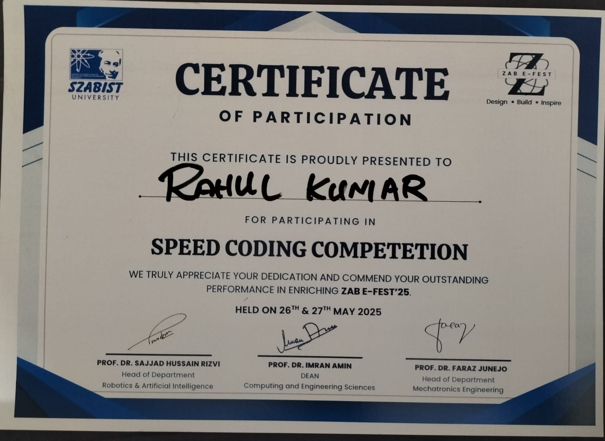

# 🏆 ZAB-E-FEST '25 — Speed Coding Competition

This repository showcases my **Certificate of Participation** in the Speed Coding Competition at **ZAB-E-FEST '25**, organized at SZABIST University Karachi.

## 📸 Certificate

## 📜 Certificate Details

| Detail | Information |
|---|---|
| **Participant** | Rahul Kumar |
| **Competition** | Speed Coding Competition |
| **Event** | ZAB-E-FEST '25 |
| **Institution** | SZABIST University Karachi |
| **Event Dates** | 26–27 May 2025 |
| **Recognition** | Certificate of Participation |

## 💻 About the Achievement

Participated in the Speed Coding Competition at ZAB-E-FEST '25, demonstrating an interest in programming, logical thinking, and problem-solving.

## 🎯 Skills Demonstrated

- Programming and coding practice
- Logical thinking
- Problem-solving
- Competitive learning

## 👨‍💻 About Me

**Rahul Kumar**  
BS Software Engineering Student · SZABIST Karachi

> Keep learning • Keep building • Keep creating 🚀

## 🔗 Connect With Me

- [LinkedIn](https://www.linkedin.com/in/rahul-maheshwari-7375152b0)
- [GitHub Profile](https://github.com/rahulkumar10319)
